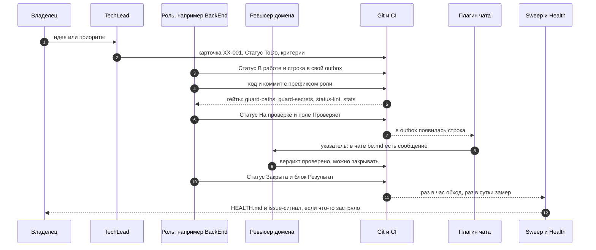
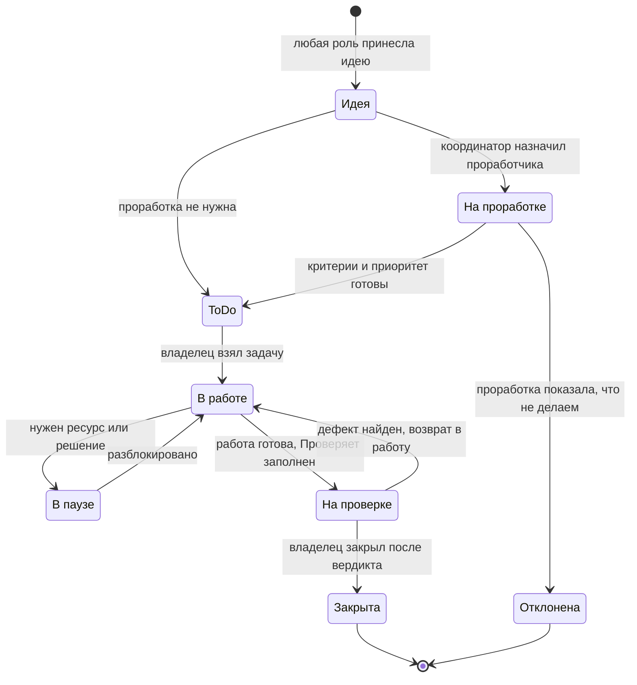
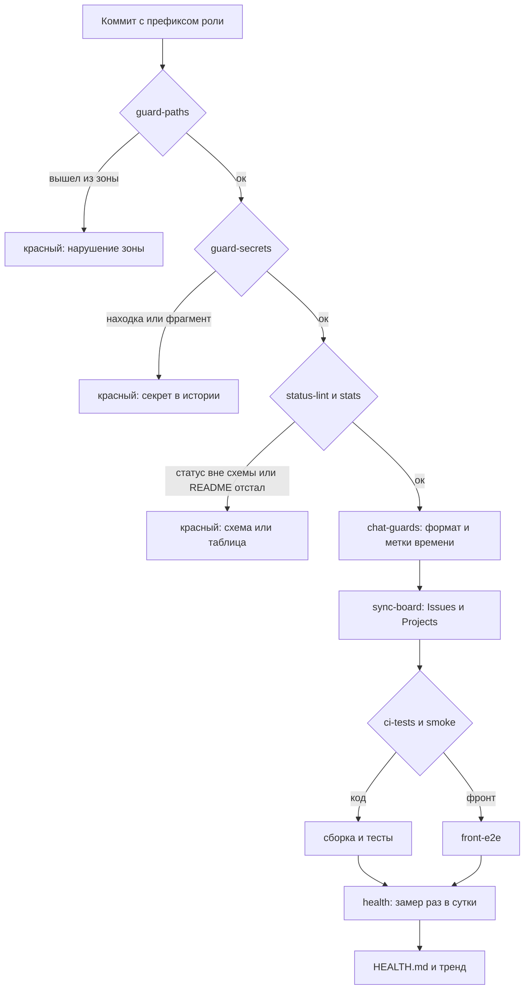

# Как устроено взаимодействие ролей в DSH

Отчёт о том, как устроена петля «задача → роль → чат → проверка → закрытие», когда роли
живут не в одном чате, а в отдельных тредах DSH. Версия актуальная на 07.11.2026: учтены
восемь статусов, ревью по домену, доставка чата плагином, единый источник инструментов,
дашборд здоровья, бюджет инструкций и протокол git-инцидента.

Документ переносимый: цифры взяты из XDiary, но механика воспроизводима в любом проекте
(как завести — `AGENTS.md` §8, шаблоны — `templates/`).

---

## 1. Что такое петля

**Петля** — замкнутый цикл работы, который живёт в git, а не в переписке:

```
задача файлом → роль-агент берёт → пишет в свой outbox → ревьюер проверяет → владелец закрывает
      ↑                                                                              │
      └───────────────────── новая задача из дефекта / следующая по приоритету ←──────┘
```

Полный цикл на одной задаче — с доставкой в тред, гейтами и замером:



Важно, что видно на схеме: **закрывает не ревьюер**, а владелец задачи; доставку в тред
делает плагин, а не человек; гейты стоят на коммите, а обход и замер — по расписанию.

Петля замыкается на пяти сущностях. Уберите любую — появится ручная пересылка сообщений,
и это перестанет быть петлёй.

| Сущность | Что это | Где живёт |
|---|---|---|
| **Роль** | отдельный тред агента со своей задачей и памятью | DSH, 1 тред = 1 роль |
| **Зона** | папки, куда роль пишет | `loop.config.json` → `zones` |
| **Задача** | карточка `.md` со статусом и критериями | `<backlog>/<роль>/XX-001.md` |
| **Чат** | по файлу на роль (outbox), один писатель на файл | `<backlog>/chat/<роль>.md` |
| **Проверка** | ревьюер верифицирует, владелец закрывает | чат + поле `Статус:` |

---

## 2. Роли

| Роль | Ядро (пишет только сюда) | Служебное |
|---|---|---|
| **PO** | `01-user-stories/`, `02-cjm/` | `chat/po.md` |
| **Architect** | `03-ddd/`, `04-architecture/` | `arch/`, `chat/ar.md` |
| **BackEnd** | `6-msa/` | `0-df-issue/`, `back-end/`, `chat/be.md` |
| **FrontEnd** | `8-front/` | `front-end/`, `chat/fe.md` |
| **DevOps** | `7-deploy/` | `tools/`, `.github/`, `devops/`, `chat/do.md` |
| **TestEngineer** | `9-tests/` | `tester/`, `chat/te.md` |
| **TechLead** | — (координатор) | все папки задач, `chat/tl.md`, `README.md`, `CHANGELOG.md` |
| **LoopMaster** (`@LM`) | — (процесс) | `AGENTS.md`, `loop.config.json`, `chat/lm.md`, правила здесь |

Два правила, которые держат зоны:

1. **Одна «своя» папка плюс служебный минимум** (своя папка задач + свой outbox). Без
   служебного роль не может закрыть задачу и ответить в чате — петля рвётся.
2. **Выход за зону не делаем молча**: нужен файл в чужой папке — строка `→ @TL` в свой
   outbox, координатор создаёт задачу владельцу.

Проверка — `tools/check_paths.py` (по префиксу коммита; `--strict` = только ядро,
`--range` = аудит истории).

**Процессная роль отдельно.** LoopMaster не ведёт задачи продукта и не пишет код: правила,
линтеры, миграции статусов, шаблоны, дашборд. Ему адресуют **только процессные вопросы** —
статусы задач и прогонов он не читает (иначе превращается во второе «горлышко»).

---

## 3. Задача

Один файл = одна задача. ID с префиксом роли: `BE-001`, `TE-004`, `DO-009`.

```markdown
- **Статус:** ToDo
- **Приоритет:** P0
- **Источник:** ADR-002              ← трассировка, откуда взялась
- **Зависимости:** —
- **Прорабатывает:** @AR            ← только «На проработке»
- **В работе с:** 2026-11-05        ← только «В работе»
- **Проверяет:** @TL + коммит/CI    ← только «На проверке»
- **Пауза:** причина · **Разблокирует:** @DO/доступ · **До:** дата ← только «В паузе»
```

**Восемь статусов, без синонимов:**

```
Идея → На проработке → ToDo → В работе → На проверке → Закрыта
                        ↑         ↓
                        └── В паузе        (+ Отклонена)
```

Та же схема как граф переходов — с тем, **кто** имеет право ставить статус:



Что кодирует граф: **через ревью нельзя проскочить** (в `closed` нет прямой стрелки из
`work`), **пауза обратима**, а `rejected` — терминальный, а не «закрыто».

Полная схема с матрицей переходов и обязательными полями — `STATUSES.md`.
Линтер — `tools/status_lint.py` (значение из списка, обязательные поля под статус,
синонимы «Открыта/Готово/Done/Пауза» — ошибка). Миграция старых значений —
`tools/migrate_statuses.py` (dry-run по умолчанию).

Почему восемь, а не четыре: «Открыта» смешивала три разных состояния (сырая идея;
идея, которую кто-то проверяет на соответствие ADR; проработанная задача с критериями),
а «В работе» — работу и осознанную остановку. Из-за этого задачи «в паузе» выглядели
как прогресс, а обход (`sweep`) не мог отличить застой от блокировки.

**Закрывает владелец задачи** — всегда. Ревьюер пишет «проверено, можно закрывать»,
но `Статус: Закрыта` ставит тот, кто делал.

---

## 4. Проверка: домен, а не «всё на координатора»

Горлышко петли — верификация. Пока проверяет один TL, остальные улучшения упираются
в один тред. Поэтому ревью распределено по домену задачи:

| Домен (по папке задачи) | Ревьюер |
|---|---|
| архитектура: `03-ddd/`, `04-architecture/`, ADR, контракты | `@AR` |
| инфраструктура: `7-deploy/`, `.github/`, `tools/`, секреты, деплой | `@DO` |
| продукт: `01-user-stories/`, `02-cjm/` | `@PO` |
| код сервисов, фронт, тесты, остальное | `@TL` (он же арбитр в споре) |

Три правила: **саморевью запрещено** (если автор задачи — ревьюер её домена, проверяет
`@TL`); **TL не перепроверяет** доменного ревьюера (только полноту `## Результат`);
**закрывает по-прежнему владелец**.

Соблюдение измеряется (см. §8): сейчас `15/26` задач на проверке/в работе имеют ревьюера
по домену — остальные 11 это долг, а не инцидент.

---

## 5. Чат: outbox-модель

Один файл на роль — поэтому одновременная запись в один файл невозможна, merge-конфликтов
нет по конструкции.

```
<backlog>/chat/
  be.md  do.md  fe.md  te.md  ar.md  tl.md  po.md  lm.md   ← каждый пишет только в свой
  _dialogue.md                                            ← авто-сводка (генерируется)
```

Строка — одна, канон: `- [YYYY-MM-DD HH:mm] → @КОМУ: текст`. Парсер понимает и без
скобок, и нескольких адресатов через `+`, но канон один: **один адресат на строку**.
Многострочные сообщения и строки без `→ @КОМУ:` не доставляются.

**Метка времени — из часов машины**, `python tools/chat_lint.py --next-stamp`, не по памяти.
Если в проекте уже накопились «уехавшие» метки — они не переписываются, а отсекаются
строкой-маркером «метка = часы машины»: линтер проверяет только то, что после неё.

### Доставка: плагин `dsh-loopmaker`

Роль не сидит в чате — плагин читает файлы и **приносит** адресованное в тред роли.

- `notifyStyle: pointer` — по умолчанию приходит указатель «в чате tl.md есть сообщение
  от TechLead (03:19) — посмотри файл», а не весь текст: дешевле по контексту;
- дедуп по ключу `файл|время|адресат|хеш текста` — повторно не доставляет;
- `wake: live-only` — будит только открытый тред (закрытый ждёт, пока его откроют);
- тормоза против пинг-понга: батч-окно, порог кругов на пару, потолок реплик в час,
  заморозка пары, эскалация координатору;
- файл без записи в `roles` **пропускается** (с версии 0.3 — с предупреждением в логе).

Цифры XDiary: **1138 сообщений** в девяти outbox'ах, **1263** доставки, очередь пуста.

---

## 6. Git-дисциплина (без неё петля врёт)

- **Префикс роли в коммите:** `be:`, `fe:`, `do:`, `te:`, `ar:`, `tl:`, `po:` (и
  `chat(te):`, `docs(do):`). Коммит без префикса считается человеческим и пропускается
  guard'ом — поэтому префикс это не украшение, а способ отличить робота от владельца.
- **Незакоммиченное не существует.** Рабочее дерево у всех ролей **одно**; правка,
  которая «потом закоммитится», может исчезнуть в чужом `rebase`/`autostash`. Так пропали
  `paths`-правки @DO: работа «была сделана», а в `origin/main` её не было.
- **Проверяй артефакт в `origin`, а не в дереве:** «проверено» = `git show origin/main:<файл>`
  или ссылка на run/PR. Дважды отчитались «проверено», глядя в незакоммиченное дерево.
- **Git-инцидент: STOP объявляет координатор** — и только при потере или повреждении
  (конфликт `rebase`, «cannot autostash», пропавшие коммиты, чужой force-push). Обычный
  non-fast-forward — рутина: `fetch` + `rebase`, без STOP. Восстанавливает один, роли
  замирают; историю не переписываем.

---

## 7. Автоматика

| Workflow | Что делает |
|---|---|
| `guard-paths` | роль не вышла за зону (по префиксу коммита) |
| `stats` | таблица статусов в README актуальна |
| `status-lint` | статусы и обязательные поля по схеме |
| `chat-guards` | формат чата + метки времени (`--strict-times`) + секреты + NUL-байты |
| `guard-secrets` | секреты и их **фрагменты** в задачах/чате/доках (в CI — по диапазону пуша) |
| `guard-tools` | копии инструментов не разошлись с манифестом |
| `sync-board` | задачи → GitHub Issues + Projects |
| `sweep` | раз в час: что стоит без движения и где «обещано, но не начато» |
| `health` | раз в сутки: дашборд (см. §8), коммитит `HEALTH.md` + историю |
| `ci-*` | сборка/тесты/деплой по путям сервисов |

Как гейты складываются в путь одного коммита:



Ключевое: **лёгкие гейты идут первыми** (секунды), тяжёлые — по путям кода; переписка
и задачи тяжёлые джобы не запускают вообще, поэтому правка в чате не отменяет чужой E2E.

Принципы, которые выстраданы:

1. **Переписка не гоняет тяжёлое CI.** Чат и задачи исключены из тяжёлых workflow;
   guard'ы для них — отдельный лёгкий workflow.
2. **Отменённый прогон — не доказательство.** Ни зелёный, ни красный: для приёмки нужен
   прогон, завершившийся сам.
3. **`cancelled` ≠ «кто-то нажал отмену».** GitHub держит один pending на группу; новый
   пуш **вытесняет** ожидающий прогон — он завершается как `cancelled`, не сделав шага.
4. **Гейт соответствует артефакту.** Один `smoke` на фронт и бэк связывает их: фронтовый
   баг блокирует доставку бэкенда, и появляется соблазн обойти гейт руками. Ручной обход
   запрещён — чинится гейт.
5. **Запуск и диагностика прогонов — зона инфраструктурной роли;** координатор только
   читает результат.

---

## 8. Инструменты и метрики

**Один источник инструментов.** В LoopMaker 15 скриптов; в проект они копируются
(репозиторий-шаблон приватный, CI проекта его не читает). Чтобы копия не «уехала» молча:
манифест `tools/.sources.json` (sha256 тела на момент синка) + `tools/sync_tools.py`
(`--check` в CI, `--report` — диф с шаблоном, `--pull` — пересинхронизация). Сейчас
`13/13` копий совпадают.

**Дашборд здоровья** (`tools/health.py` → `HEALTH.md` + `health/history.jsonl`, раз в сутки):

| Метрика | Норма | Сейчас |
|---|---|---|
| Ошибки статусов (линтер) | 0 | 0 |
| Задачи без движения | 0 | 0 |
| Гигиена гейтов (stats/chat/wf) | 3/3 | 3/3 |
| CI p95 (худший джоб) | < 300 с | 157 с |
| Вопросы в чате без ответа | 0 | 0 |
| Метки чата вне шкалы / порядок | 0 / 0 | 0 / 0 |
| Ревью по домену (§4) | 100% | 15/26 |
| Копии инструментов разошлись | 0 | 0 |

Дашборд **не гейт**: он не валит CI и ничего не чинит. Его работа — превратить «кажется,
всё нормально» в число и тренд.

**Бюджет инструкций.** Все `AGENTS.md` воркспейса грузятся вместе, лимит — 64 КиБ. При
переполнении файл **молча** перестаёт подхватываться: у нас так выпали правила проекта
(сумма двух файлов была 67 КБ). Лечение: `AGENTS.md` ≤ 16 КБ (норма), детали и истории —
в `RULES.md`.

---

## 9. Что показала практика

Цифры XDiary на 07.11.2026:

| Показатель | Значение |
|---|---|
| Задач в бэклоге | 146 (113 закрыто, 13 отклонено) |
| Сообщений в чате | 1138 |
| Доставок плагином | 1263 |
| Workflow | 24 |
| Инструментов (проект / шаблон) | 23 / 15 |
| `test` p95 | 157 с (лимит окна — 300 с) |

Уроки, которые стоили дороже всего:

1. **Пустой ход опаснее ошибки.** «Беру задачу, потом сделаю» без единого tool call —
   и со стороны кажется, что работа идёт. Лечение: первый шаг = `Статус: В работе` +
   строка в чат.
2. **Правило без гейта не работает.** Каждое правило, добавленное после инцидента,
   получало проверку: статусы → линтер, секреты → сканер, копии → манифест, метки → линтер.
3. **Молчаливое выпадение — самый дорогой класс дефектов.** Неизвестный файл чата
   пропускался без строки в логе; правила выпадали из бюджета инструкций; секреты в
   задачах никто не сканировал. Везде лечение одно: сделать состояние видимым.
4. **Общее дерево — общий риск.** Пока правки живут в рабочем дереве, их может стереть
   чужой `rebase`. Коммит сразу — дешевле, чем восстановление.
5. **Координатор не должен быть единственным ревьюером.** Ревью по домену двигает
   верификацию, но требует дисциплины в поле `Проверяет:` — и метрики, чтобы это видеть.

---

## 10. Как это повторить

1. Скопировать `AGENTS.md`, `RULES.md`, `STATUSES.md`, `loop.config.json`, `tools/`,
   `templates/`.
2. Прописать в конфиге зоны (роль → `core`/`service`), папку бэклога, роли, статусы.
3. Завести треды: по одному на роль, заголовок `Проект | Роль` (по нему плагин находит
   сессию).
4. Включить гейты из §7 — по одному, начиная с `guard-paths` и `guard-secrets`.
5. Прогнать `python tools/stats.py --write` и `python tools/health.py --write` — получить
   первую таблицу и первый замер.
6. Проверить цикл на одной задаче: создать → взять → `На проверке` → верить → закрыть.
   Если хоть что-то пришлось передавать руками — вернуться к §1 и найти пропуск.
